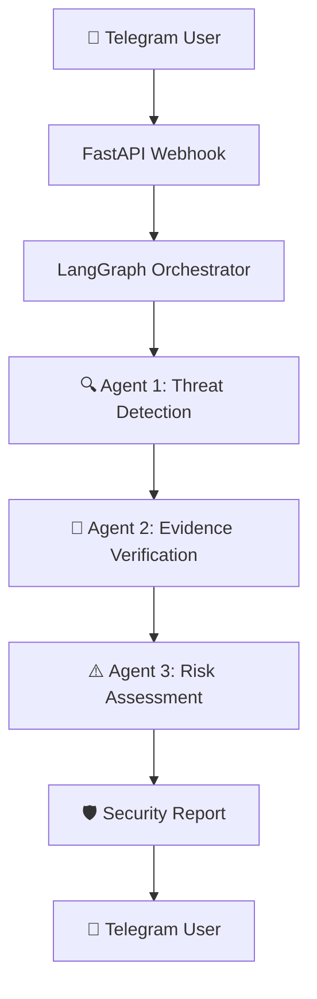

<div align="center">

# 🛡️ NexMind CyberSafe AI

### Intelligent Multi-Agent Cybersecurity Assistant

**Detect Suspicious Messages • Assess Risks • Stay CyberSafe**

[](https://www.python.org/)
[](https://www.langchain.com/langgraph)
[](https://fastapi.tiangolo.com/)
[](https://t.me/NexmindCybersafe_bot)


**Developed by Team NexMind | Agentathon Project**

[🚀 Try Live Bot](https://t.me/NexmindCybersafe_bot) ·
[📖 Documentation](#-project-overview) ·
[⚙️ Installation](#️-installation) ·
[🗺️ Roadmap](#️-development-roadmap)

</div>

---

## 📖 Project Overview

**NexMind CyberSafe AI** is a multi-agent cybersecurity assistant designed to help users identify potentially fraudulent messages, phishing attempts, and online scams.

Built with **Python, LangGraph, FastAPI, and Telegram**, CyberSafe AI coordinates three specialized agents to analyze suspicious messages and provide understandable security assessments.

Users can send or forward suspicious Telegram text messages directly to the bot without copying and pasting them into another application.

> **Our Mission:** Make practical cybersecurity guidance accessible to everyone, including users without technical cybersecurity knowledge.

---

## 🎯 Problem Statement

Phishing attacks, online fraud, impersonation, and deceptive financial messages pose serious cybersecurity challenges.

Many users struggle to identify suspicious communications or understand the precautions needed to protect themselves.

**CyberSafe AI addresses this problem through:**

- 🔍 Automated detection of suspicious message indicators.
- 🤖 Coordinated analysis using three specialized agents.
- ⚠️ Explainable risk assessments.
- 🔐 Practical cybersecurity recommendations.
- 📱 Accessible interaction through Telegram.

---

## ✨ Key Features

| Feature | Description | Status |
|---|---|---|
| 🤖 Telegram Bot | Automatic message analysis | ✅ Live |
| 📩 Forwarded Messages | Analyze forwarded Telegram text | ✅ Live |
| 🔍 Threat Detection | Identify suspicious indicators | ✅ Implemented |
| 🧾 Evidence Inspection | Preliminary offline URL checks | ✅ Implemented |
| ⚠️ Risk Assessment | LOW, MEDIUM, HIGH classifications | ✅ Implemented |
| 🧠 LangGraph | Three-agent workflow coordination | ✅ Implemented |
| 📊 Security Reports | Reasons and safety recommendations | ✅ Implemented |
| 🔒 Duplicate Tracking | SQLite-based update tracking | ✅ MVP |
| 🌐 Cloud Deployment | FastAPI hosted on Render | ✅ Live |
| 🖼️ Screenshot Analysis | Analyze suspicious images | 🔜 Planned |
| 🌍 Multilingual Support | Nigerian Pidgin and other languages | 🔜 Planned |
| 🛡️ Threat Intelligence | External domain reputation checks | 🔜 Planned |

---

## 🧠 Multi-Agent Architecture

CyberSafe AI consists of three specialized agents coordinated through **LangGraph**.



### 🔍 Agent 1 — Threat Detection

Identifies suspicious indicators such as:

- Urgent or threatening language.
- Requests for passwords, PINs, BVNs, or OTPs.
- Suspicious instructions and links.
- Financial incentives or potentially fraudulent offers.

**Output:** Threat indicators and extracted URLs.

### 🧾 Agent 2 — Evidence Verification

Performs preliminary offline inspection of suspicious URLs and available indicators.

**Output:** URL warnings, findings, and verification status.

> External threat-intelligence verification is planned for a future release.

### ⚠️ Agent 3 — Risk Assessment

Combines findings from the previous agents to produce:

- A heuristic risk score from 0 to 100.
- LOW, MEDIUM, or HIGH risk classification.
- Explanations of suspicious indicators.
- Recommended cybersecurity precautions.

**Note:** Risk scores are heuristic indicators, not calibrated probabilities of fraud.

---

## 🛠️ Technology Stack

| Layer | Technology |
|---|---|
| Programming | Python |
| Multi-Agent Orchestration | LangGraph |
| Backend API | FastAPI |
| ASGI Server | Uvicorn |
| Messaging | Telegram Bot API |
| Database | SQLite |
| Development | Google Colab |
| Version Control | GitHub |
| Hosting | Render |

---

## 📂 Project Structure

```text
NexMind-CyberSafe-AI/
│
├── agents/
│   ├── __init__.py
│   ├── detection.py
│   ├── verification.py
│   └── risk_assessment.py
│
├── main.py
├── update_tracker.py
├── requirements.txt
├── render.yaml
├── .gitignore
└── README.md
```

---

## ⚙️ Installation

### 1️⃣ Clone the Repository

```bash
git clone https://github.com/Rald10/NexMind-CyberSafe-AI.git
cd NexMind-CyberSafe-AI
```

For private repositories, GitHub access is required.

### 2️⃣ Create a Virtual Environment

```bash
python -m venv .venv
```

Activate on Windows:

```powershell
.venv\Scripts\activate
```

Activate on Linux/macOS:

```bash
source .venv/bin/activate
```

### 3️⃣ Install Dependencies

```bash
pip install -r requirements.txt
```

### 4️⃣ Configure Environment Variables

Set the following variables securely:

```env
TELEGRAM_BOT_TOKEN=your_telegram_bot_token
TELEGRAM_WEBHOOK_SECRET=your_secure_webhook_secret
CYBERSAFE_TRACKER_DB=telegram_updates.db
```

**Never commit actual tokens or secrets to GitHub.**

### 5️⃣ Run the Application

```bash
uvicorn main:app --host 0.0.0.0 --port 8000
```

Check the health endpoint:

```text
http://localhost:8000/health
```

Expected response:

```json
{
  "status": "ok",
  "service": "CyberSafe AI"
}
```

Telegram webhook functionality requires a public HTTPS endpoint and webhook registration.

---

## 📱 How to Use CyberSafe AI

<div align="center">

### 🚀 [CLICK HERE TO OPEN CYBERSAFE AI](https://t.me/NexmindCybersafe_bot)

</div>

**Step 1:** Open the Telegram bot.

**Step 2:** Tap **Start**.

**Step 3:** Send or forward a suspicious text message.

**Step 4:** Receive a preliminary cybersecurity assessment.

### Example Message

> URGENT! Your bank account will be blocked. Click this link and send your OTP immediately.

### Example Security Assessment

| Assessment | Result |
|---|---|
| Risk Level | 🔴 HIGH |
| Heuristic Score | 80/100 |
| Urgency Detected | Yes |
| Sensitive Information Request | Yes |
| Suspicious Action | Yes |

**Recommendations:**

- Never share OTPs, PINs, or passwords.
- Avoid opening suspicious links.
- Verify financial requests through official channels.
- Report suspected fraud to appropriate authorities.

---

## 🧪 Testing and Evaluation

The MVP has passed functional tests covering:

- Individual agent execution.
- LangGraph workflow orchestration.
- FastAPI health endpoint.
- Telegram webhook authentication.
- Forwarded-message processing.
- SQLite duplicate tracking.
- Application reload persistence tests.
- Live direct-message responses.
- Live forwarded-message responses.

**Future evaluation metrics:**

- Precision.
- Recall.
- F1-score.
- False-positive rate.
- Response latency.
- Agent ablation performance.

Functional testing does not establish real-world phishing detection accuracy.

---

## 🗺️ Development Roadmap

### ✅ Phase 1 — Functional MVP

- [x] Three specialized agents.
- [x] LangGraph orchestration.
- [x] Telegram bot integration.
- [x] Forwarded-message analysis.
- [x] Risk assessment and recommendations.
- [x] Render deployment.

### 🔄 Phase 2 — Security and Reliability

- [ ] Durable database storage.
- [ ] Robust webhook retry and recovery.
- [ ] Privacy and data-retention controls.
- [ ] User feedback functionality.
- [ ] Monitoring and automated testing.

### 🔜 Phase 3 — Advanced Cybersecurity

- [ ] Nigerian-specific scam detection categories.
- [ ] External threat-intelligence integration.
- [ ] Official-domain verification.
- [ ] Screenshot-based phishing detection.
- [ ] Machine-learning-based classification.
- [ ] Nigerian Pidgin and multilingual support.

### 🔬 Phase 4 — Research and Evaluation

- [ ] Build a labeled Nigerian scam-message dataset.
- [ ] Evaluate individual agents.
- [ ] Conduct comparative experiments.
- [ ] Perform ablation studies.
- [ ] Document findings for research publication.

---

## 🔐 Security and Privacy

CyberSafe AI follows basic security practices:

- Telegram credentials are configured through environment variables.
- Webhook requests are authenticated using a secret token.
- Suspicious URLs are not automatically visited by the current verification agent.
- SQLite tracks processed Telegram updates.
- Users deliberately submit messages for analysis.

**Known limitations:** The MVP uses heuristic detection, and free cloud hosting does not guarantee uninterrupted availability or durable local storage.

Users should avoid submitting unnecessary sensitive personal information.

---

## 👥 Meet Team NexMind

**Team NexMind** is a five-member technology team focused on building accessible solutions using multi-agent systems.

**Project:** CyberSafe AI

**Competition:** Agentathon

**Focus:** Cybersecurity, AI Agents, Digital Safety, and Responsible Technology.

---

## ⚠️ Disclaimer

CyberSafe AI provides preliminary cybersecurity assessments for educational and informational purposes.

It does not guarantee that a message, sender, or website is safe or fraudulent.

Always independently verify suspicious claims through trusted official channels.

---

<div align="center">

### 🛡️ Stay Alert. Stay Secure. Stay CyberSafe.

**Built by Team NexMind**

[🚀 Launch Telegram Bot](https://t.me/NexmindCybersafe_bot)

⭐ Star this repository to support the project!

</div>
